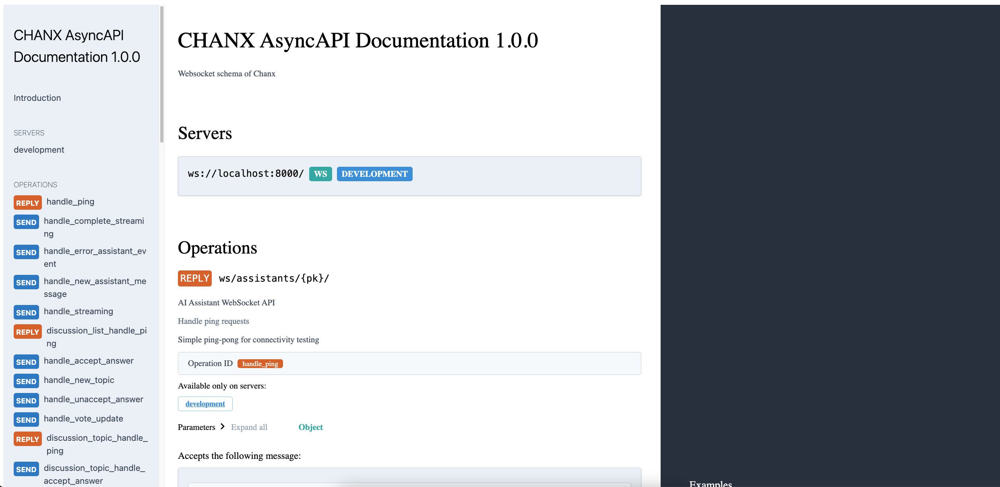

Introduction
============

Chanx is a framework for building typed WebSocket APIs in Python. You describe each
message as a Pydantic model and write one handler per message; Chanx does the routing,
validation, broadcasting and documentation around them. It runs on Django Channels,
FastAPI, and any ASGI framework (through
`fast-channels <https://fast-channels.readthedocs.io/>`_).

The gap it fills
----------------

The WebSocket layers Python developers use today stop at the connection:

- **Django Channels** gives you consumers and channel layers, then hands every message to
  a single ``receive()`` method. Routing, validation, error replies and documentation are
  yours to write, and every team writes them differently.
- **FastAPI** gives you a socket. There are no groups, no channel layer for broadcasting
  across processes, and no way to push to a client from an HTTP endpoint or a worker.

On a growing project that turns into long ``if``/``elif`` chains over ``data["action"]``,
hand-rolled payload checks, and a frontend team asking which messages exist and what
they look like. The answer usually lives in someone's head or in a wiki page that is
already out of date.

How Chanx works
---------------

**1. Messages are models.** Each message has a ``Literal`` ``action`` and a typed
payload:

.. code-block:: python

    class ChatMessage(BaseMessage):
        action: Literal["chat"] = "chat"
        payload: ChatPayload

**2. Handlers are typed methods.** Chanx reads each handler's argument type and builds a
discriminated union of everything the consumer accepts. Incoming JSON is validated
against it and dispatched to the matching handler; invalid messages get a structured
``error`` reply and never reach your code.

.. code-block:: python

    @channel(name="chat")
    class ChatConsumer(AsyncJsonWebsocketConsumer):
        groups = ["lobby"]

        @ws_handler(output_type=ChatNotification)
        async def handle_chat(self, message: ChatMessage) -> None:
            await self.broadcast_message(ChatNotification(payload=message.payload))

        @ws_handler
        async def handle_ping(self, message: PingMessage) -> PongMessage:
            return PongMessage()

**3. Your server code can talk to clients.** Events sent with ``broadcast_event`` or
``send_event`` travel through the channel layer (Redis or in-memory) to
``@event_handler`` methods, so a view, a Celery task or an ARQ worker can push to
connected clients.

**4. The code is the contract.** Because handlers declare what they accept and send, Chanx
generates an AsyncAPI 3.0 spec and an interactive docs page from them. Typed clients are
generated from that spec: Python with ``chanx generate-client``, TypeScript with
`chanx-js <https://huynguyengl99.github.io/chanx-js/>`_. When a handler changes, the docs
and clients change with it.

What else is included
---------------------

- **Authentication**: ``DjangoAuthenticator`` reuses DRF permission classes and
  querysets; ``BaseAuthenticator`` covers custom schemes. See
  :doc:`user-guide/framework-integration`.
- **Topics**: many subscriptions over one socket, with per-topic authorization. See
  :doc:`user-guide/topics`.
- **Mixins**: share handlers between consumers. See :doc:`user-guide/mixins`.
- **Testing**: communicators for both frameworks that send typed messages and collect
  replies until a completion signal. See :doc:`user-guide/testing`.
- **Structured logging** with ``structlog``, with per-action filtering.
- **Static typing**: Chanx itself is checked with mypy and pyright in strict mode, and
  handler signatures are typed end to end.

When Chanx fits
---------------

Chanx is a good fit when WebSockets carry a real API: several message types, more than
one person working on them, and a frontend or another service that needs to know the
shapes. It is also useful on FastAPI whenever you need groups or server-initiated
messages.

It is not the right tool when:

- you stream **binary frames** (raw audio, video, files): Chanx consumers speak JSON and
  reject binary frames;
- you need the **Socket.IO** protocol or its client libraries;
- the socket is a single, one-off stream with no message protocol, where a plain
  framework endpoint is simpler.

See :doc:`comparison` for how Chanx relates to Channels, FastAPI, Broadcaster and
Socket.IO.

Next steps
----------

- :doc:`quick-start`: build a working consumer on Django or FastAPI.
- :doc:`installation`: extras for the client generator and generated clients.
- :doc:`tutorial-django/prerequisites` or :doc:`tutorial-fastapi/prerequisites`: build a
  complete application step by step.
